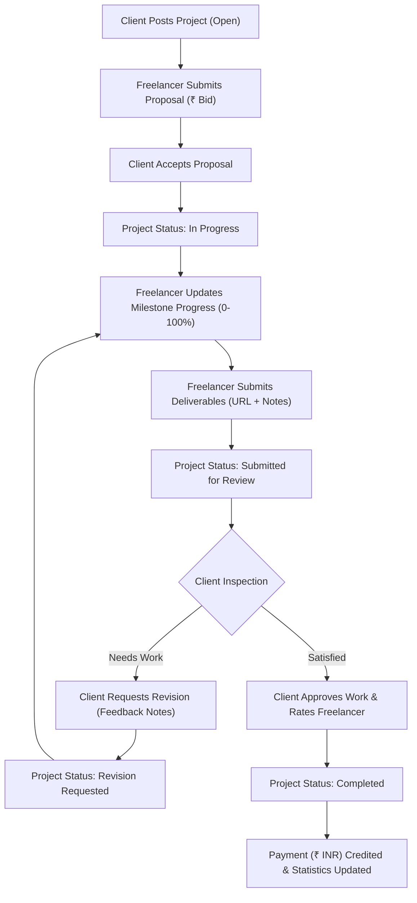

# SkillBridge – Local Freelancer Work Verification Platform (Full-Stack)

SkillBridge is an enterprise full-stack web application connecting freelancers with clients, tracking project milestones, and enforcing a strict **Work Verification Workflow** before deliverable sign-off and payment release.

The platform is built with a **React.js** frontend, an **ASP.NET Core Web API (C# .NET 10)** backend, and a **Microsoft SQL Server (`SkillBridgeDB`)** database.

---

## 🏗️ Technology Stack

### Frontend
- **Framework:** React.js (Vite)
- **Routing:** React Router DOM (Role-guarded routes)
- **Icons:** Lucide React
- **Currency:** Indian Rupee (`₹ INR`) with Indian formatting (`en-IN`)
- **Styling:** Custom responsive CSS design system with CSS custom properties

### Backend
- **Framework:** C# ASP.NET Core Web API (.NET 10.0)
- **ORM:** Entity Framework Core 10.0 (Code-First Migrations)
- **Database:** Microsoft SQL Server (`.\SQLEXPRESS` / `SkillBridgeDB`)
- **Authentication:** JWT (JSON Web Tokens) with Role-Based Access Control (`Freelancer`, `Client`, `Admin`)
- **Password Hashing:** PBKDF2 HMAC-SHA256 with cryptographic salt
- **API Documentation:** Swagger UI / OpenAPI specification

---

## 🗄️ Database Design (`SkillBridgeDB`)

The database consists of 9 normalized tables with foreign key constraints, cascade rules, decimal financial precisions (`decimal(18,2)`), and unique indexes:

1. **`Users`**: Primary user identity, role, credentials, and profile image.
2. **`FreelancerProfiles`**: Hourly rates in ₹, bio, skills, experience, rating, review count, total earnings.
3. **`ClientProfiles`**: Company name, industry, location, website, verified payment badge, total spent.
4. **`Projects`**: Client ID, assigned Freelancer ID, category, budget (₹), duration, status, progress %, deliverables.
5. **`ProjectMilestones`**: Milestone deliverables, amounts (₹), due dates, and completion timestamps.
6. **`WorkRequests`**: Freelancer proposals / bids with estimated days, cover letters, and statuses (`Pending`, `Accepted`, `Rejected`).
7. **`WorkSubmissions`**: Version-tracked deliverables (v1, v2, etc.), delivery URLs, release notes, verification statuses, and client feedback.
8. **`Reviews`**: Star ratings (1–5) and client feedback comments for completed projects.
9. **`Notifications`**: Real-time notifications for proposals, progress updates, submissions, revisions, and approvals.

---

## ⚙️ Work Verification Workflow



---

## 🚀 Running the Application

### 1. Prerequisites
- **Node.js** (v18+ recommended)
- **.NET 10.0 SDK** (installed)
- **Microsoft SQL Server / SQLEXPRESS** (running locally)

### 2. Start the ASP.NET Core Backend
From the project root:
```bash
npm run api
```
*Or directly via dotnet:*
```bash
dotnet run --project SkillBridge.API/SkillBridge.API.csproj --urls "http://localhost:5000"
```

- API Base URL: `http://localhost:5000/api`
- Swagger UI Documentation: `http://localhost:5000/swagger`
- Health Endpoint: `http://localhost:5000/api/health`

### 3. Start the React Frontend
In a new terminal:
```bash
npm run dev
```

The frontend will run at `http://localhost:5173`.

---

## 🔑 Demo Accounts (Pre-Seeded)

The database is pre-seeded with test accounts:

| Role | Name | Email | Password | Details |
| :--- | :--- | :--- | :--- | :--- |
| **Freelancer** | Arjun Sharma | `freelancer@skillbridge.in` | `password123` | Senior Full-Stack & React Developer, Rate: ₹1,500/hr, 4.9★ |
| **Client** | Priya Nair | `client@skillbridge.in` | `password123` | TechNova Solutions India, Verified Client |
| **Freelancer** | Rohan Gupta | `rohan@skillbridge.in` | `password123` | UI/UX & Mobile App Designer, Rate: ₹1,200/hr, 4.8★ |
| **Client** | Vikram Malhotra | `vikram@zenithtech.in` | `password123` | Zenith Retail Ventures |

---

## 🌐 REST API Endpoints Overview

| Area | Method | Endpoint | Description |
| :--- | :--- | :--- | :--- |
| **Auth** | `POST` | `/api/auth/register` | Register new Freelancer or Client |
| **Auth** | `POST` | `/api/auth/login` | Authenticate and obtain JWT token |
| **Auth** | `GET` | `/api/auth/me` | Get currently logged-in user profile |
| **Projects** | `GET` | `/api/projects` | Search & filter projects by category, budget, status |
| **Projects** | `GET` | `/api/projects/{id}` | Get project details, milestones, submissions |
| **Projects** | `GET` | `/api/projects/my` | Get current user's projects |
| **Projects** | `POST` | `/api/projects` | Client creates new project with ₹ budget |
| **Projects** | `PUT` | `/api/projects/{id}/progress` | Freelancer updates progress percentage |
| **Proposals** | `POST` | `/api/workrequests` | Freelancer submits bid for an open project |
| **Proposals** | `GET` | `/api/workrequests/my` | Freelancer gets submitted proposals |
| **Proposals** | `PUT` | `/api/workrequests/{id}/accept` | Client accepts proposal & activates project |
| **Verification** | `POST` | `/api/projects/{id}/submit` | Freelancer submits deliverables link & notes |
| **Verification** | `POST` | `/api/projects/{id}/verify` | Client approves work, leaves rating & releases payment |
| **Verification** | `POST` | `/api/projects/{id}/request-revision` | Client requests revisions with feedback notes |
| **Freelancers** | `GET` | `/api/freelancers` | Search & filter freelance talent in India |
| **Freelancers** | `PUT` | `/api/freelancers/me` | Freelancer updates profile & skills |
| **Notifications** | `GET` | `/api/notifications` | Get user notifications |
| **Notifications** | `PUT` | `/api/notifications/read-all` | Mark all notifications read |
